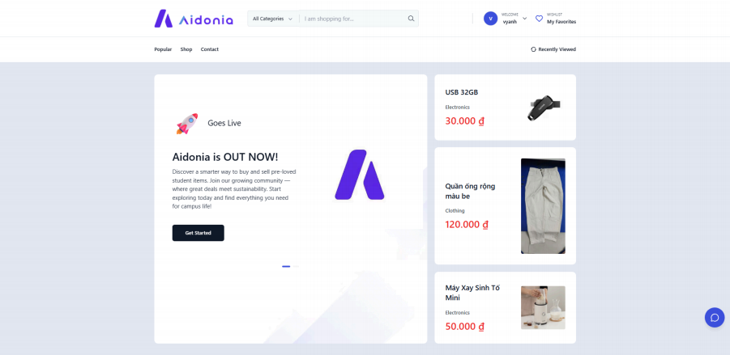
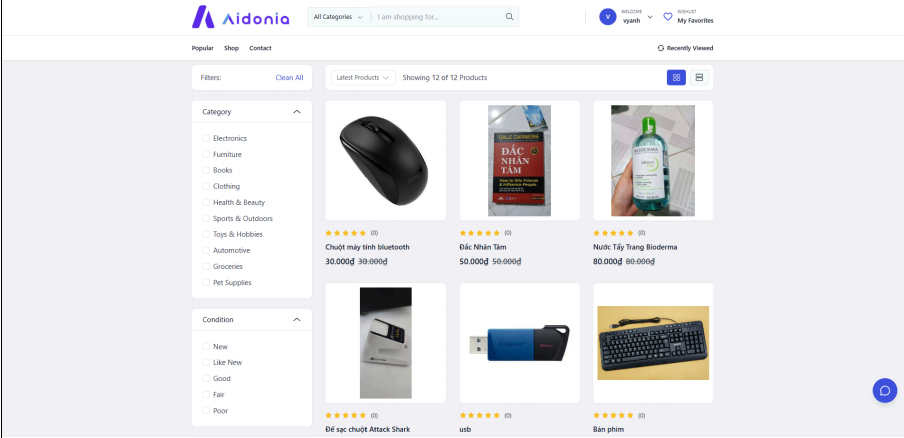
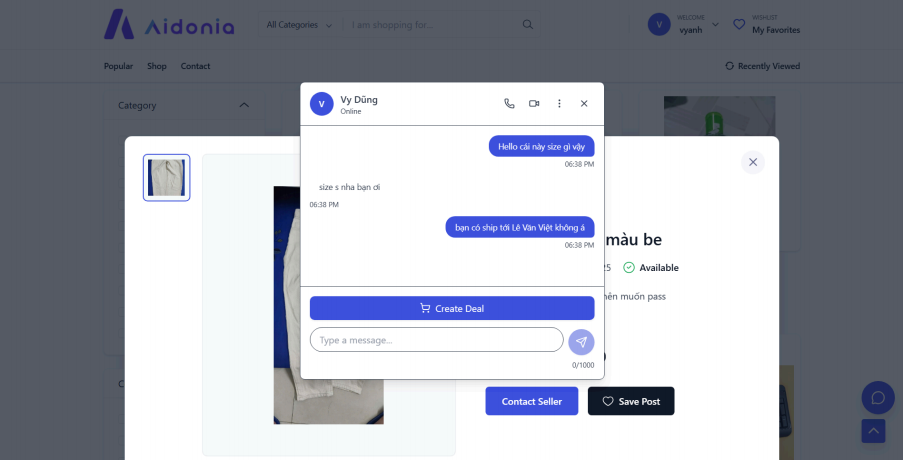
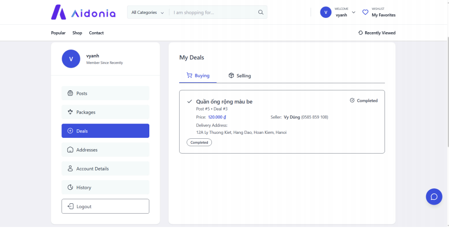
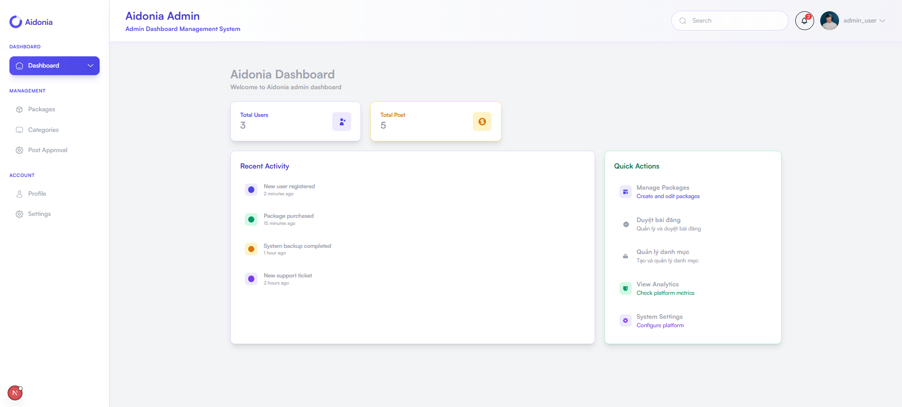
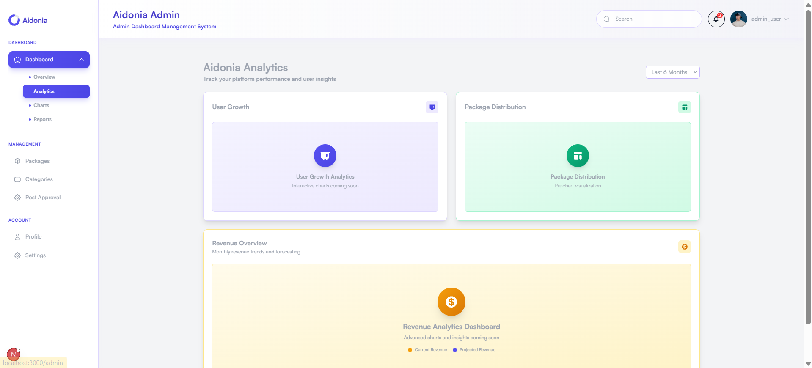
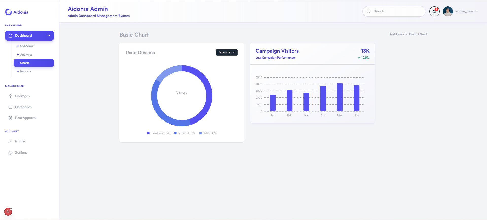
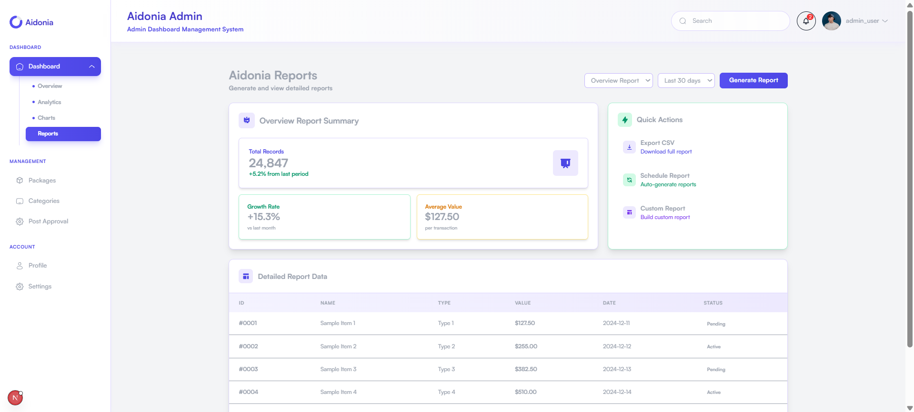

<!-- title: AIDONIA -->
<br />
<div align="center">
  <h1 align="center">Aidonia</h1>
  <p align="center">
    A dedicated C2C secondhand marketplace platform tailored for university students
  </p>
  <a href="https://aidonia.vercel.app/">Go to Aidonia!</a>
</div>

## Overview

Aidonia is a full-stack C2C (Customer-to-Customer) circular economy marketplace designed specifically for university students to buy, sell, or exchange secondhand items safely and affordably within their campus community.

## Description

Aidonia solves the problem of high secondhand trading risks and scams on unverified social media groups (e.g., Facebook Groups). Built with a "Student-First" approach, the platform requires campus email verification (`@fpt.edu.vn`) to establish a trusted trading ecosystem. It features smart listing management, real-time messaging between buyers and sellers, deal tracking, and premium listing packages for enhanced item visibility.

## Information & Contact

- Course: FPT University HCMC - EXE201 (Fall 2025)
- Project: Aidonia - Secondhand Student Marketplace Platform
- Supervisor: Thanhntl2
- Team Members:

| No. | Student ID | Full Name | Role | Responsibilities |
| --- | ---------- | --------- | ---- | ---------------- |
| 1   | SE180000   | Vy Anh | CEO | Overall project coordination & strategic decisions |
| 2   | SE180001   | Trần Phước Nguyên | CMO | Go-to-Market strategies, social media & growth |
| 3   | SE180002   | Nguyễn Ngọc Tiến | CTO | System architecture, frontend integration & AI features |
| 4   | SE180003   | Nguyễn Thái Nam | CSO | Customer success, user dispute handling & feedback |
| 5   | SE180004   | Nguyễn Thành Nam | CFO | Financial planning, Unit Economics (CAC/LTV) & pricing |

## Screenshots


_Homepage: Featured products, promotional banners, and category navigation_


_Product Catalog: Advanced filtering by category, price, and product condition_


_Real-time Chat: Direct buyer-seller negotiation modal_


_My Deals: Deal management and status tracking for buying and selling_






_Admin Dashboard: Platform analytics, post approval, and category management_

## Features

### Core Features

1. **User Management & Campus Verification**
   - **Student Email Verification**: Secure registration restricted to university email domains.
   - **User Profiles**: Profile management, personal listings history, and deal tracking.
   - **Role-Based Access**: Guest, Verified Student, and Administrator portals.

2. **Smart Listing & Discovery**
   - **Item Management**: Post items across categories (Books, Electronics, Fashion, Furniture).
   - **Product Condition Tagging**: Clear labeling for New, Like New, Good, Fair, or Poor conditions.
   - **Advanced Search & Filtering**: Multi-criteria search by category, price range, and keywords.

3. **Deals & Monitization System**
   - **Deal Creation**: Create structured buying/selling agreements directly from chat.
   - **Premium Listing Packages**: Subscription tiers (Try, Beginner, Basic, Premium, Unlimited) for priority display and verified badges.

### Advanced Features

1. **Real-Time Ecosystem**
   - **In-App Live Chat**: Real-time messaging between buyers and sellers without leaving the site.
   - **Instant Toast Alerts**: Real-time feedback using Sonner and React Hot Toast.

2. **Security & Management**
   - **Post Approval Workflow**: Admin review system for listing compliance and scam prevention.
   - **Firebase Integration**: Secure asset management via Firebase Storage and Authentication.

### User Interface

- **Modern Responsive Design**: Built with Next.js 15, React 19, and Tailwind CSS.
- **Theme Support**: Seamless Light/Dark mode toggling (`next-themes`).
- **Interactive Dashboards**: Data visualization powered by ApexCharts and JSVectorMap.

### Quality Features

- **Next.js Turbopack**: High-speed development and production build execution.
- **Type Safety**: End-to-end TypeScript implementation.
- **Performance Analysis**: Integrated Webpack Bundle Analyzer and Lighthouse performance scripts.

## Tech Stack

### Frontend

![Next.js][Next.js] ![React][React] ![TypeScript][TypeScript] ![TailwindCSS][TailwindCSS]
![Redux][Redux] ![Zustand][Zustand] ![Firebase][Firebase] ![Axios][Axios]

### UI Components & Libraries

![Preline][Preline] ![Lucide][Lucide] ![ApexCharts][ApexCharts]

### Development & Build Tools

![ESLint][ESLint] ![Prettier][Prettier] ![PostCSS][PostCSS]

<!-- MARKDOWN LINKS & IMAGES -->

[Next.js]: https://img.shields.io/badge/Next.js_15-000000?style=for-the-badge&logo=nextdotjs&logoColor=white
[React]: https://img.shields.io/badge/React_19-20232A?style=for-the-badge&logo=react&logoColor=61DAFB
[TypeScript]: https://img.shields.io/badge/TypeScript_5-007ACC?style=for-the-badge&logo=typescript&logoColor=white
[TailwindCSS]: https://img.shields.io/badge/Tailwind_CSS-38B2AC?style=for-the-badge&logo=tailwind-css&logoColor=white
[Redux]: https://img.shields.io/badge/Redux_Toolkit-764ABC?style=for-the-badge&logo=redux&logoColor=white
[Zustand]: https://img.shields.io/badge/Zustand-orange?style=for-the-badge&logo=react&logoColor=white
[Firebase]: https://img.shields.io/badge/Firebase_12-FFCA28?style=for-the-badge&logo=firebase&logoColor=black
[Axios]: https://img.shields.io/badge/Axios-5A29E4?style=for-the-badge&logo=axios&logoColor=white
[Preline]: https://img.shields.io/badge/Preline_UI-0070F3?style=for-the-badge
[Lucide]: https://img.shields.io/badge/Lucide_Icons-F56565?style=for-the-badge
[ApexCharts]: https://img.shields.io/badge/ApexCharts-008FFB?style=for-the-badge
[ESLint]: https://img.shields.io/badge/ESLint-4B32C3?style=for-the-badge&logo=eslint&logoColor=white
[Prettier]: https://img.shields.io/badge/Prettier-F7B93E?style=for-the-badge&logo=prettier&logoColor=black
[PostCSS]: https://img.shields.io/badge/PostCSS-DD3A0A?style=for-the-badge&logo=postcss&logoColor=white

## Building and Usage

### Prerequisites

- **Node.js** 18.x or higher
- **npm** / **yarn** / **pnpm**
- **Firebase Project** (for Auth & Storage)

### Quick Start

```bash
# Clone the repository
git clone [https://github.com/your-organization/EXE201_FE.git](https://github.com/your-organization/EXE201_FE.git)
cd EXE201_FE/aidonia

# Install dependencies
npm install

# Setup environment variables
cp .env.example .env.local

# Start development server with Turbopack
npm run dev

# Open browser at http://localhost:3000

```

### Available Scripts

In the project directory, you can run:

```bash
npm run dev              # Run dev server with Turbopack
npm run dev:debug        # Run dev server in inspect/debug mode
npm run build            # Build the production application
npm run start            # Start production server
npm run lint             # Run ESLint code checks
npm run perf:bundle      # Analyze bundle sizes with Webpack Bundle Analyzer
npm run perf:lighthouse  # Run automated Lighthouse audit

```

### Environment Variables

#### Frontend (.env.local)

```bash
# API Gateway Configuration
NEXT_PUBLIC_API_BASE_URL=http://localhost:5000/api/
NEXT_PUBLIC_API_KEY=your_api_key_here

# Mock Mode (Set true if backend is offline)
NEXT_PUBLIC_USE_MOCK=false

# Firebase Credentials
NEXT_PUBLIC_FIREBASE_API_KEY=your_firebase_api_key
NEXT_PUBLIC_FIREBASE_AUTH_DOMAIN=exe201-aidonia.firebaseapp.com
NEXT_PUBLIC_FIREBASE_PROJECT_ID=exe201-aidonia
NEXT_PUBLIC_FIREBASE_STORAGE_BUCKET=exe201-aidonia.firebasestorage.app
NEXT_PUBLIC_FIREBASE_MESSAGING_SENDER_ID=your_sender_id
NEXT_PUBLIC_FIREBASE_APP_ID=your_app_id

```

## Project Structure

```text
EXE201_FE/
└── aidonia/
    ├── public/                     # Static assets & public images
    ├── src/
    │   ├── app/                    # Next.js 15 App Router pages & layouts
    │   │   ├── (site)/             # Public store views (Home, Shop, Cart, Deals)
    │   │   ├── admin/              # Admin dashboard (Analytics, Approval, Users)
    │   │   ├── context/            # React Context Providers (Cart, Modals)
    │   │   └── layout.tsx          # Root Application Layout
    │   ├── components/             # Reusable UI Components
    │   │   ├── admin/              # Admin components
    │   │   ├── Auth/               # Login, Signup & Verification
    │   │   ├── Cart/               # Cart drawers & checkout
    │   │   ├── Header/             # Navigation Header
    │   │   └── Shop/               # Product grids, filters & details
    │   ├── hooks/                  # Custom React Hooks
    │   ├── redux/                  # Redux Toolkit store & slices
    │   ├── services/               # API clients (Auth, Products, Deals, Firebase)
    │   ├── types/                  # TypeScript interfaces & types
    │   └── utils/                  # Utility & helper functions
    ├── .env.local                  # Local environment configuration
    ├── next.config.ts              # Next.js configuration
    ├── package.json                # Project dependencies & scripts
    └── tsconfig.json               # TypeScript configuration

```

```

